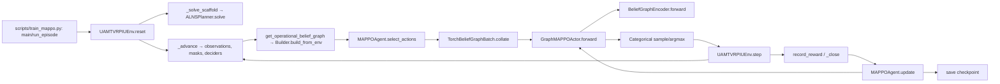
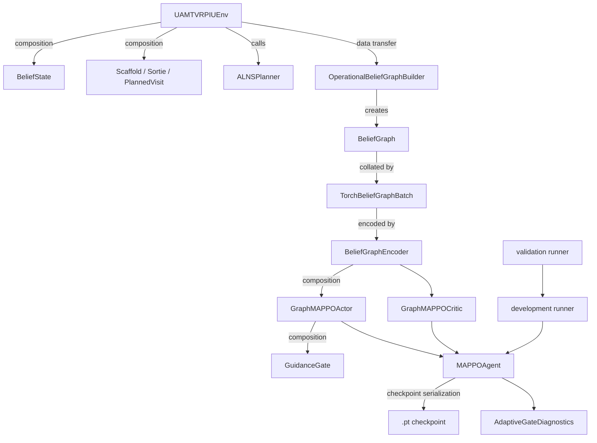

# Call graph and data flow

## Primary execution path



## Class relationships



Relationships labelled **composition** mean one object owns/references another; **data transfer** means a function returns data consumed by the next component. There is no meaningful inheritance hierarchy in the active method other than PyTorch `nn.Module` subclasses.

## Environment decision flow

1. `UAMTVRPIUEnv.reset` (`src/env/uav_env.py:119–238`) creates/reset state, calls `_solve_scaffold(initial=True)`, schedules turnaround events, then `_advance` returns decision-maker UAV IDs, actor observations, and masks.
2. `_plan_context` converts only operational belief, stock, availability, risk, and UAV status into `PlanContext`; `ALNSPlanner.solve` builds a `Scaffold`.
3. `_build_obs` concatenates `_own_feats`, `_node_feats`, `_fleet_feats`, `_event_feats`. `get_global_state` adds true-demand features for the critic only.
4. `get_operational_belief_graph` calls `OperationalBeliefGraphBuilder.build_from_env`.
5. `MAPPOAgent.select_actions` batches graph/actor inputs and calls `GraphMAPPOActor.forward`; a categorical distribution samples actions (or argmax is used when deterministic).
6. The mask first reaches actor logits in `GraphMAPPOActor.forward` and is checked again by `step`; an invalid submitted action falls back to FOLLOW and adds `P_viol`.
7. `step` handles resolve, plan edits, `_apply_movement`, then `_advance` processes events until the next decision epoch.
8. Reward is negative belief deprivation, energy, risk, resolve cost, and violation penalty for the elapsed interval.
9. `record_decisions` opens a `_Pending` per decider; `record_reward` accumulates interval reward; `_close` turns it into a trajectory transition when that UAV next decides or the episode ends.

## Graph and gate flow

`ControllerState` in the task description corresponds to the live `UAMTVRPIUEnv` plus `BeliefState`; there is no class literally named `ControllerState` in this repository.

`build_from_env` creates fixed-capacity nodes: UAV slots `0..M-1`, depot `M`, and affected-node slots `M+1..M+N`. It creates directed depot/known-node corridor edges and bidirectional UAV/location relation edges. `TorchBeliefGraphBatch.collate` makes tensors; `BeliefGraphEncoder.forward` returns per-node embeddings and a pooled graph embedding; `GraphMAPPOActor.forward` selects the acting UAV embedding and attention-weighted global graph context.

The gate implementation is exactly:

```text
gate_logit = guidance_gate.logits(plan_features)
adaptive_gate = sigmoid(gate_logit)
gate = adaptive_gate (adaptive) | fixed_gate (fixed) | 0 (none)
hybrid_logits = base_logits + beta * gate * alns_prior
masked_logits = hybrid_logits.masked_fill(action_mask == 0, -1e8)
```

This is `src/methods/graph_networks.py:303–359`; the mask value is **`-1e8`**. In fixed mode a `GuidanceGate` object is still constructed and its observability values are stored, but its output is not selected as `gate`, so it receives no policy-gradient path. Actor, prior, and mask logic are otherwise shared.

## MAPPO update flow

`update` (`src/agents/mappo_agent.py:311–582`) stacks transitions into actor observations, global critic observations, action masks, actions, old log probabilities, rewards/GAE advantages/returns, and—graph mode—graph objects, `uav_id`, 10-plan-feature vectors, and ALNS-prior action vectors. It collates graph minibatches, recomputes actor distribution and critic values, forms clipped PPO actor loss plus value/entropy terms, calls `backward`, clips gradients, and steps actor/critic Adam optimizers. Exact batch shapes are `[B, actor_dim]`, `[B, critic_dim]`, `[B, action_dim]`, `[B]` for action/log-prob/advantage/return; graph tensors are padded `[B,max_nodes,32]` node and `[B,max_edges,11]` edge features; plan features are `[B,10]`.

## Development study flow

`run_gate_learning_development.py:main` loads config, constructs a shared graph-MAPPO agent (`_make_agent`), saves its checkpoint, copies it to both branches (`_copy_initialization`), verifies component hashes, and calls `_train_branch` for `fixed` then `adaptive`. `_train_branch` uses `_run_episode`, periodic `_evaluate_checkpoint`, checkpoint/progress writes, and update collection. `validate_gate_learning_development.py:main` reloads checkpoints, `_collect_validation`s matched decisions/vectors, derives counterfactuals and matched-state effects (`evaluate_matched_states`), computes metrics, chooses `select_gate_learning_verdict`, and writes reproducibility hashes. `plot_gate_learning_development.py:plot` renders the outputs.
